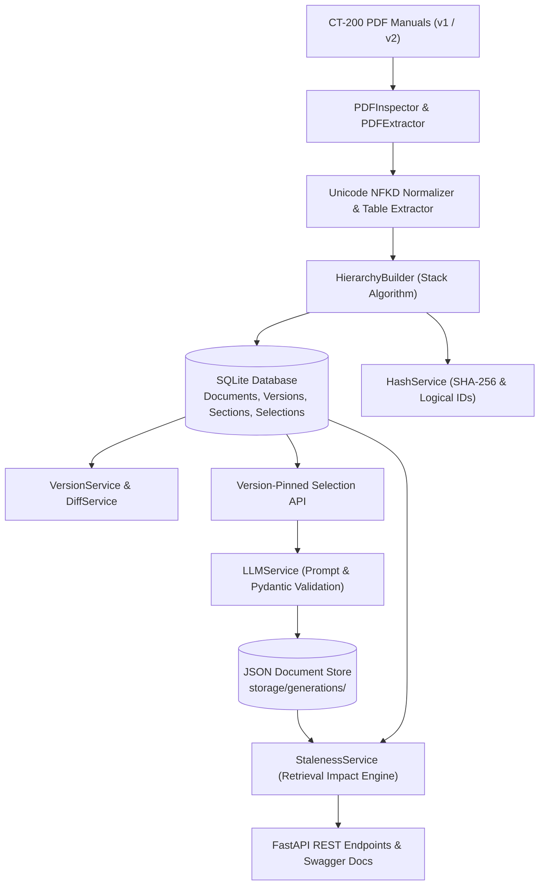

# CT-200 Intelligent Document Traceability & AI-Powered QA Test Generation System

[](https://www.python.org/)
[](https://fastapi.tiangolo.com/)
[](https://docs.pydantic.dev/)
[]()

> A production-grade document intelligence, versioning, and regulatory QA test generation platform designed for medical device engineering (FDA Class II / ISO 13485 / IEC 62304).

---

## 1. Project Overview

The **CT-200 Intelligent Document Traceability Platform** extracts, structures, and manages technical requirements from revisions of the **CardioTrack CT-200 Home Blood Pressure Monitor** user and engineering manual (`v1` and `v2`).

It solves the critical medical device engineering problem of **stale traceability**: when engineering specifications change (such as reduced cuff deflation times or battery warning thresholds), historical QA test cases linked to older requirements are flagged dynamically at retrieval time with root-cause impact classification (e.g., `NUMERICAL_THRESHOLD`, `ERROR_CODE`, `SAFETY_BEHAVIOR`).

---

## 2. Key Features

- **Forensic PDF Ingestion & OCR**: Directly extracts digital text, Unicode NFKD ligatures (`ff`, `fi`, `fl`), and embedded multi-column tables, with automatic OCR fallback for scanned pages.
- **Robust Hierarchy Reconstruction**: Stack-based parser resolves duplicate headings (`4.2 Error Codes` vs `7.1 Error Codes`), skipped hierarchy levels (`2.1.1.1` under `2.1`), and out-of-order numbering (`3.4` before `3.3`).
- **Deterministic Content Hashing**: Generates canonical SHA-256 hashes per section and establishes stable logical node IDs that persist across revisions.
- **Multi-Stage Version Matching**: Preserves historical versions intact while matching sections across revisions via path, heading similarity, parent context, and text diffs.
- **Version-Pinned Selections**: Locks exact text snapshots and content hashes at creation time, preventing selections from silently drifting to latest versions.
- **AI-Powered QA Test Generation**: Generates 3 to 5 grounded, ISO 13485-compliant QA test cases with strict Pydantic structured output validation, code-fence handling, and automatic retries.
- **NoSQL Document Storage**: Uses an immutable JSON document store (`storage/generations/`) with index querying and duplicate caching policies.
- **Real-Time Staleness Engine**: Evaluates staleness at retrieval time, differentiating between benign wording changes (`REVIEW_REQUIRED`) and critical parameter shifts (`STALE`).

---

## 3. Architecture Overview



---

## 4. Technology Stack

- **Backend**: Python 3.10+, FastAPI, Uvicorn
- **Validation**: Pydantic v2, Pydantic-Settings
- **Relational Storage**: SQLite, SQLAlchemy 2.0 ORM
- **NoSQL Storage**: Atomic JSON Document Store with index inverted lookups
- **PDF & Document Intelligence**: PyMuPDF (fitz), pdfplumber, PIL (Pillow)
- **OCR Engine**: Tesseract OCR via `pytesseract`
- **AI / LLMs**: Google Gemini API, Groq API, and Deterministic Offline Mock LLM Provider
- **Testing**: pytest

---

## 5. Directory Structure

```
CT-200-System/
├── app/
│   ├── main.py                  # FastAPI application entrypoint & lifespan
│   ├── config.py                # Environment configuration via Pydantic
│   ├── database.py              # SQLite engine, sessionmaker, Base
│   ├── models/                  # SQLAlchemy ORM models
│   │   ├── document.py          # Document entity
│   │   ├── version.py           # DocumentVersion entity
│   │   ├── section.py           # Hierarchical SectionNode entity
│   │   └── selection.py         # Version-pinned Selection entity
│   ├── schemas/                 # Pydantic validation schemas
│   │   ├── document.py          # Document & Version response schemas
│   │   ├── section.py           # SectionNode & Diff response schemas
│   │   ├── selection.py         # Selection creation & snapshot schemas
│   │   └── generation.py        # TestCase & Retrieval Traceability schemas
│   ├── services/                # Core business logic engines
│   │   ├── pdf_inspector.py     # Deep static pre-extraction inspector
│   │   ├── pdf_extractor.py     # PDF text, table, and heading extractor
│   │   ├── ocr_service.py       # Tesseract OCR fallback service
│   │   ├── hierarchy_builder.py # Stack-based hierarchy reconstruction
│   │   ├── hash_service.py      # Canonical SHA-256 & logical ID generator
│   │   ├── version_service.py   # Multi-stage version matching & status
│   │   ├── diff_service.py      # Unified text diff generator
│   │   ├── storage_service.py   # NoSQL JSON document store
│   │   ├── llm_service.py       # AI QA generation, prompt & Pydantic retries
│   │   └── staleness_service.py # Real-time staleness & impact detection
│   ├── api/routes/              # REST API endpoints
│   │   ├── ingestion.py         # PDF upload and version ingestion
│   │   ├── documents.py         # Document and version browsing
│   │   ├── sections.py          # Section lookup, search, and changes
│   │   ├── selections.py        # Version-pinned selection creation
│   │   ├── generation.py        # LLM QA test generation & caching
│   │   └── retrieval.py         # Traceability and staleness retrieval
│   └── utils/
│       └── normalization.py     # Unicode NFKD ligature & string normalizer
├── data/
│   ├── ct200_manual_v1.pdf      # Technical manual Revision 1 (6 pages)
│   └── ct200_manual_v2.pdf      # Technical manual Revision 2 (7 pages)
├── storage/
│   └── generations/             # JSON store for LLM-generated test cases
├── docs/
│   ├── APPROACH.md              # In-depth engineering rationale & Decision Log
│   └── INSPECTION_REPORT.md     # Document inspection findings & matrix
├── scripts/
│   └── demo_workflow.py         # End-to-end 12-step live demonstration
├── tests/                       # Automated test suite (24 tests)
│   ├── test_parser.py
│   ├── test_hierarchy.py
│   ├── test_versioning.py
│   ├── test_generation.py
│   ├── test_staleness.py
│   └── test_api.py
├── .env.example
├── .gitignore
├── requirements.txt
└── README.md
```

---

## 6. Installation & Quickstart

### 6.1 Prerequisites
- Python 3.10 or higher
- Git

### 6.2 Clone and Setup Virtual Environment
```bash
# Clone the repository
git clone <repository-url>
cd "CT-200 Intelligent Document Traceability & AI-Powered QA Test Generation System"

# Create and activate virtual environment
python -m venv .venv

# On Windows:
.venv\Scripts\activate

# On Linux/macOS:
source .venv/bin/activate
```

### 6.3 Install Dependencies
```bash
pip install -r requirements.txt
```

### 6.4 Environment Variables Configuration
Copy the example `.env.example` to `.env`:
```bash
copy .env.example .env
```
Default `.env` settings:
```env
APP_ENV=development
APP_PORT=8000
DATABASE_URL=sqlite:///./ct200_system.db
GENERATIONS_STORAGE_DIR=./storage/generations

# LLM Configuration (mock runs fully offline without API keys)
LLM_PROVIDER=mock
GEMINI_API_KEY=
GROQ_API_KEY=
LLM_MODEL=gemini-1.5-flash
MAX_RETRIES=3
REQUEST_TIMEOUT=30
```

---

## 7. Running the Application

### 7.1 Start the FastAPI Server
```bash
uvicorn app.main:app --host 127.0.0.1 --port 8000 --reload
```
Once started, access:
- **Interactive Swagger Documentation**: [http://127.0.0.1:8000/docs](http://127.0.0.1:8000/docs)
- **ReDoc Documentation**: [http://127.0.0.1:8000/redoc](http://127.0.0.1:8000/redoc)
- **Health Check**: [http://127.0.0.1:8000/](http://127.0.0.1:8000/)

---

## 8. End-to-End Workflow Demonstration

Run the automated live demonstration script that executes the complete 12-step regulatory workflow in seconds:

```bash
python scripts/demo_workflow.py
```

### What the Demonstration Executes:
1. **Ingests v1.0** from `data/ct200_manual_v1.pdf` (extracting 27 sections).
2. **Retrieves sections** and displays the reconstructed hierarchy tree.
3. **Creates a version-pinned selection** targeting Section `3.2` (Inflation) and Section `4.2` (Error Codes).
4. **Generates QA test cases** using the medical-device prompt and validates via Pydantic.
5. **Retrieves initial generation** and verifies initial `CURRENT` status.
6. **Ingests v2.0** from `data/ct200_manual_v2.pdf` (extracting 28 sections, preserving v1).
7. **Performs version diff** showing changes (e.g. 40 mmHg -> 30 mmHg, 2s -> 1.5s).
8. **Retrieves original generation again** and demonstrates real-time dynamic transition to **`STALE`**.
9. **Displays root cause impact analysis** (`NUMERICAL_THRESHOLD`) and human QA review recommendations.

---

## 9. API Reference & Usage Examples

### 9.1 Ingest Document Version
```bash
curl -X POST "http://127.0.0.1:8000/api/documents/ingest" \
     -F "file_path=data/ct200_manual_v1.pdf" \
     -F "document_id=doc_ct200" \
     -F "version_label=v1.0"
```

### 9.2 List Top-Level Sections
```bash
curl -X GET "http://127.0.0.1:8000/api/documents/doc_ct200/sections"
```

### 9.3 Get Specific Section & Content Hash
```bash
curl -X GET "http://127.0.0.1:8000/api/sections/ver_doc_ct200_v1_sec_3_2_cuff_inflation_sequence"
```

### 9.4 Full-Text Search
```bash
curl -X GET "http://127.0.0.1:8000/api/sections/search?q=inflation"
```

### 9.5 Compare Section Across Versions
```bash
curl -X GET "http://127.0.0.1:8000/api/sections/ver_doc_ct200_v1_sec_3_2_cuff_inflation_sequence/changes"
```

### 9.6 Create Version-Pinned Selection
```bash
curl -X POST "http://127.0.0.1:8000/api/selections" \
     -H "Content-Type: application/json" \
     -d '{
       "selection_name": "Inflation & Error Handling",
       "document_id": "doc_ct200",
       "version_id": "ver_doc_ct200_v1",
       "node_ids": [
         "ver_doc_ct200_v1_sec_3_2_cuff_inflation_sequence",
         "ver_doc_ct200_v1_sec_4_2_error_codes"
       ]
     }'
```

### 9.7 Generate QA Test Cases
```bash
curl -X POST "http://127.0.0.1:8000/api/generations/{selection_id}"
```

### 9.8 Retrieve Generation with Real-Time Staleness
```bash
curl -X GET "http://127.0.0.1:8000/api/generations/{generation_id}"
```

---

## 10. Automated Testing

The repository includes a comprehensive automated test suite with **24 unit and integration tests** covering all assignment edge cases:

```bash
python -m pytest -s -v
```

### Test Coverage Highlights:
- **`tests/test_parser.py`**: Unicode NFKD ligature decomposition, static pre-inspector diagnostics, table extraction, and content hashing invariance to whitespace.
- **`tests/test_hierarchy.py`**: Explicit unit tests for:
  - Disambiguation of duplicate headings (`4.2 Error Codes` vs `7.1 Error Codes`).
  - Skipped hierarchy levels (`2.1.1.1` under `2.1`).
  - Out-of-order numbering (`3.4` before `3.3`).
  - Clinical classification numbered lists retained in body text.
- **`tests/test_versioning.py`**: Matching unchanged, modified, and newly added sections (`5.3 Data Export`) across revisions.
- **`tests/test_generation.py`**: Pydantic schema validation, malformed JSON recovery, rejection of missing fields, rejection of invalid priorities, test case count bounds [3, 5], and mock LLM grounding.
- **`tests/test_staleness.py`**: Staleness classification for numerical threshold changes, error code shifts, wording changes (`REVIEW_REQUIRED`), and source deletion (`SOURCE_REMOVED`).
- **`tests/test_api.py`**: Complete FastAPI integration flow from ingestion to staleness retrieval.

---

## 11. Known Limitations & Future Work

- **Vector Diagrams**: Diagram labels embedded as raw vector bezier curves are bypassed by raster-only OCR fallbacks.
- **Multi-Page Table Stitching**: Tables spanning across page breaks are currently treated as separate block entities.
- **Multi-Tenant Authorization**: Enterprise role-based access control (RBAC) and 21 CFR Part 11 electronic signature audit trails.

See [docs/APPROACH.md](docs/APPROACH.md) for full architecture details and the **Mandatory Technical Decision Log**.
